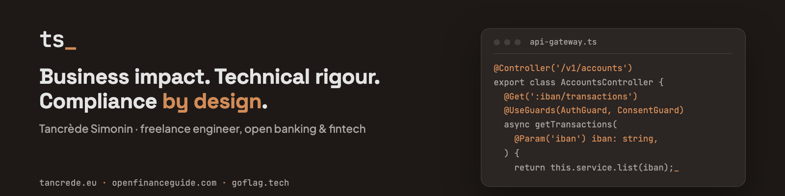

<a href="https://tancrede.eu/en"><picture>
  <source media="(prefers-reduced-motion: reduce)" srcset="assets/banner.png">
  
</picture></a>

**Freelance engineer, open banking & fintech.** I design and build secure, compliant APIs for banks and fintechs, from the product decision to production. Freelance since 2019, based in Marseille, France.

### Right now

The PSD2 APIs of **L by LCL Pro**, through Theodo Fintech: architecture, development, compliance, pentest support, DevOps and DevSecOps.

### Open source and side projects

#### [goflag](https://github.com/tancredesimonin/goflag) · [goflag.tech](https://goflag.tech)

A CLI that flags invisible site defects in CI: broken links, missing translation pages, a robots.txt that contradicts your pages, misconfigured SEO metadata. JSON-first, MIT. It also ships as a Next.js library, and as an MCP server so an AI agent can audit the site it is editing.

```bash
npx @goflag/cli https://example.com
```

#### [Open Finance Guide](https://openfinanceguide.com)

Open banking, for those who read it and those who code it. The PSR obligation by obligation, the STET spec down to the paragraph. Free, independent, in four languages.

### How I work

- **Business first.** I start from the business need and the customer impact, and take a product from idea to production. More than code.
- **Technical rigour.** TypeScript, NestJS, DDD, hexagonal architecture, CQRS and event sourcing, and the infrastructure when it's needed.
- **Security and compliance by design.** PSD2, RTS, SCA, OAuth2 / OIDC and GDPR are built in from day one, not bolted on at the end.
- **Agentic AI, with method.** Coding agents framed by written instructions in every repository, tests and CI. I stay accountable for every line shipped.

### Stack

`TypeScript` `Node.js` `NestJS` `Next.js` `PostgreSQL` `Terraform`

### Elsewhere

[tancrede.eu](https://tancrede.eu/en) · [LinkedIn](https://www.linkedin.com/in/tancredesimonin) · [openfinanceguide.com](https://openfinanceguide.com) · [goflag.tech](https://goflag.tech)

A project, a question, or just want to talk? [Write to me](https://tancrede.eu/en/contact).

<sub>Most of my client work lives in private repositories.</sub>
